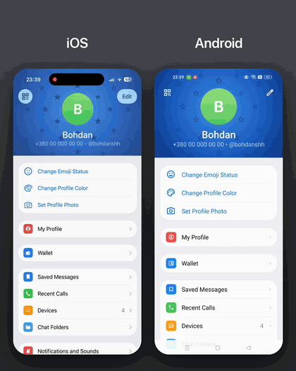

# Telegram Profile Animation

A recreation of Telegram's profile header in React Native: as you scroll, the avatar merges into the Dynamic Island on iOS and slides out through the top of the screen on Android.

<p align="center">
  
</p>

## Project structure

```
assets/lottie/  avatar masks
src/
  app/          Expo Router screens
  components/   avatar (Skia + Lottie mask), star pattern, profile header, settings list
  constants/    colors, header metrics, iPhone models with a Dynamic Island
  hooks/        avatar motion, header layout, scroll tracking
```

## Running

Runs in Expo Go: start the dev server and scan the QR code with the Expo Go app.

```bash
yarn install
yarn start
```

## Stack

Expo SDK 57 · Expo Router · React Native Skia · Reanimated · expo-symbols

## Credits

The avatar mask and the animation curves come from [Telegram iOS](https://github.com/TelegramMessenger/Telegram-iOS), which is licensed under GPL v2:

- `assets/lottie/avatar-mask-island.json` is `UserAvatarMask.tgs` from the Telegram iOS repository, unzipped (`.tgs` is gzipped Lottie JSON), with its layers renamed.
- `assets/lottie/avatar-mask-top-edge.json` is the same file with the `Line` layer's in-point moved from frame 0 to 75, so the line only appears once it's lifted off screen.

---

Not affiliated with Telegram.
